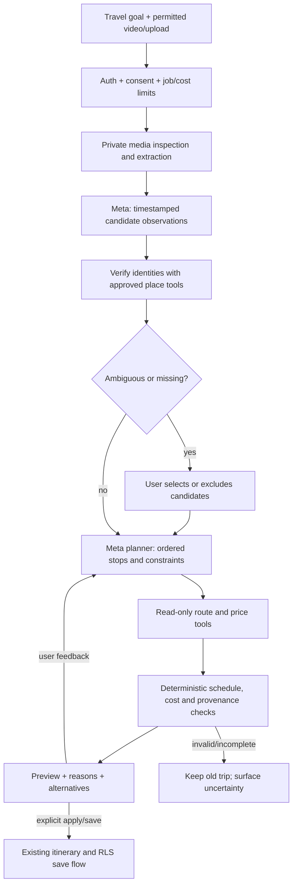

# Proposed agentic architecture

Design only,27 October 2026. Existing deterministic protections are reusable; the new Meta agent/tools below do not exist yet. No autonomous purchasing, credential manipulation or customer messaging is part of this architecture.

## System boundary

SSE is a progress transport, not durable job storage. Media jobs need their own owner-scoped persistent state and cleanup; a disconnected browser must not leave uncontrolled loops. The existing itinerary stream and quota RPCs provide patterns, not a ready media-job implementation.

## Meaningful reasoning and tool loop

1. Parse user goal into dates, travelers/rooms, accessibility constraints, pace, preferred areas, per-night and total budgets, locked/purchased stops and uncertainty tolerance.
2. Extract observations only from authorized available modalities. Link each proposed stop to frame/transcript timestamps; distinguish observed text from inferred place name.
3. Resolve identities before ordering; detect duplicate candidates, conflicting cities and impossible travel distances. Ask the user only for unresolved choices that materially affect the plan.
4. Construct a feasible ordered itinerary respecting arrival, departure buffer, opening-time evidence if available and travel-time windows. Request read-only tools for the exact needed gaps.
5. Compare two meaningful alternatives, e.g. verified budget lodging versus a higher quote with shorter transfers; include total whole-stay cost and uncertainty, not just a cheaper nightly sticker.
6. Calculate totals/durations outside the model. Enforce locks and source/date/currency/occupancy constraints. Unknown fare is unknown, not zero.
7. Return a preview, reasons and evidence. A revision reuses verified facts where still valid but invalidates stale route/hotel quotes when endpoints/dates change. Apply/save requires explicit user action; failed generations preserve the old trip.

This demonstrates perception→identity verification→tool selection→constraint reasoning→revision→explanation. Tool count alone is not success. Expose a compact action/evidence trace, never hidden chain-of-thought or secret-bearing raw provider responses.

## Proposed tools and authority

| Tool | Inputs → outputs | Authority / reuse |
|---|---|---|
| `extract_video_observations` | Owner job/media handle + modality settings → timestamped candidates | Server holds provider file IDs; Meta adapter; no arbitrary remote fetch |
| `resolve_places` | Candidate + locality context → zero/one/many source-backed identities | New curated/approved location resolver; seed `app/verified-places.ts`, locations and airports; not a paid Places call by default |
| `search_flights` | Validated query → dated indicative one-adult fares | Wrap `worker/index.js` functions through typed adapters; cache/limits; no ticket purchase |
| `search_hotels` | Exact dates/occupancy/budget/area → validated full-stay quotes | `worker/hotel-discovery.js`, `lite-hotel.js`; preserve quote checks and read-only endpoint allowlist |
| `find_activity_options` | Exact verified city + attraction → from-price products | `worker/viator.js`; distinguish ticket vs bundled tour; no automatic booking or claim of final option availability |
| `compare_routes` | Verified endpoints/date/modes → durations/steps/fare evidence or unknown | Existing local route data and separately authorized Google request budget; no Google data mixed into OSM storage |
| `calculate_trip_budget` | Verified/reference/unknown item amounts and traveler units → deterministic subtotal/range/missing costs | Reuse accounting semantics; monetary math never delegated to unconstrained text |
| `validate_and_preview` | Draft + current itinerary revision → validated diff/reasons/conflicts | Reuse `validatePlan`, `validateTransferOrder`, `applyAIPlan`; server must recheck locks/version |
| `save_approved_itinerary` | Explicit user approval + revision-bound preview → saved trip | Existing owner-scoped Supabase path; not callable by arbitrary model tool request |

Forbidden agent tools: supplier Prebook/Book/Pay/cancel, Midtrans checkout/refund, Telegram send, generic shell/SQL/eval, secret reveal/rotation, unrestricted URL fetch, arbitrary Supabase table access. A tool requesting these is denied and surfaced, not executed.

## State and schemas to add after approval

Proposed private `media_jobs`: id,ownerId,state,sourceKind,consentVersion,inputHash,privateObjectKey,providerFileId,expiresAt,progress,errorCode,usageReservation,version. RLS must scope metadata; service-only fields must not be available to browser roles. No auth/session/card fields or permanent external signed URLs.

`PlaceCandidate`: stable candidateId, timestamp range, candidateName, city/country hypotheses, evidenceKind, confidence and ambiguity. `VerifiedPlace`: source/provider ID, canonical name/locality/coordinates, public evidenceURL, checkedAt and verificationStatus. A high-confidence candidate is not automatically VerifiedPlace.

`AgentRun`: parent job, trip revision, read-only tool invocations and sanitized result summaries, actual model/usage, call budget, suggested changes and stop reason. Keep provenance separate from user-facing narrative. Store only the minimum necessary; propose24h raw-media TTL and30day optional diagnostic metadata retention, subject to owner/privacy approval.

## Revision, failure and concurrency invariants

- Purchased, pending and `aiLocked` records survive every revision; explicit user unpinning is separate from a prompt. The current `aiProtected` client helper alone is not a server authority boundary for a new autonomous tool API.
- Use trip revision/hash and idempotent run key; reject stale saves and duplicate quota settlement. One successful run consumes at most one entitled result, despite internal model/tool retries. Do not reset legacy passes or increase paid access.
- Cap iterations/calls/concurrency/elapsed time and stop with a useful partial preview if evidence remains missing. Network access grants no permission to buy or bypass a CAPTCHA.
- Prompt injection in titles, captions, OCR, supplier pages or tool output remains untrusted content. Model can propose registered tool arguments; code validates them, controls egress and authenticates the caller.
- A job failure cannot mark payment/booking successful, replace a previously valid hotel with an area label, or turn an unknown fare into a zero-cost claim.
- Show evidence-backed reasons such as shorter transfer, matching room capacity or known whole-stay total. Do not use generated rationales as substitute evidence.

Meta's [tool calling guide](https://dev.meta.ai/docs/tool-calling) confirms the application executes developer-defined tools and returns their results. The bounded registry and human approval boundaries above are SortTrip's proposed design, not a verified Meta execution trace. Evaluation metrics and acceptance tests are in [IMPLEMENTATION_ROADMAP.md](IMPLEMENTATION_ROADMAP.md).
