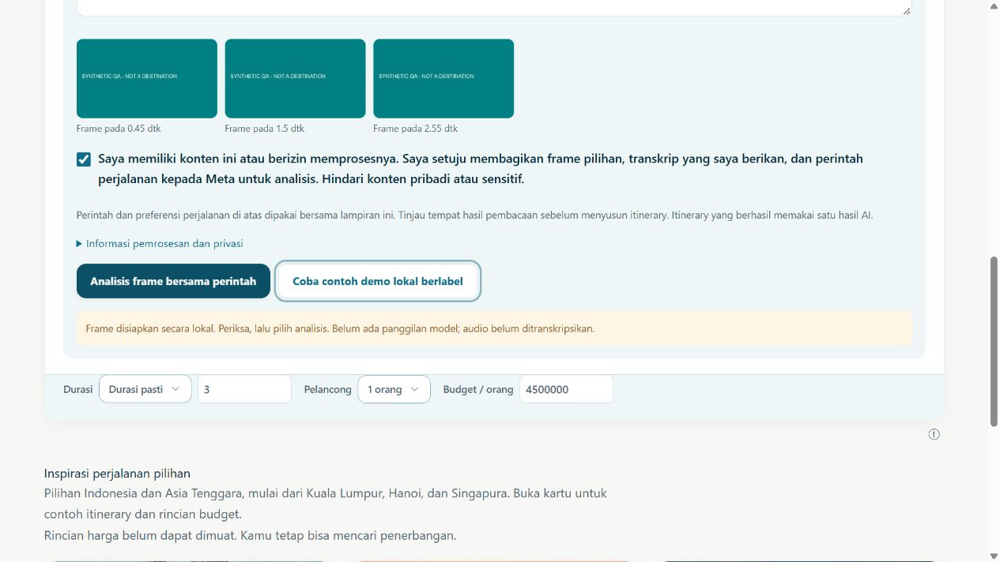

# QA Tahap 2B

27 Oktober 2026. **Regresi lokal PASS; end-to-end Meta → Save/RLS nyata BLOCKED.**

## Hasil terbaru

- **398 tes lulus, 0 gagal, 0 dilewati** setelah perubahan source final. Termasuk 14 tes Phase2B, regresi flight/hotel/pembayaran dengan mock, penggabungan input, schema, URL, budget dan UI.
- TypeScript dan Vite production build PASS. Peringatan bundle >500 kB tetap ada; tidak dianggap gagal atau diselesaikan.
- Lokalisasi **1.598 key**, 0 error / literal JSX belum diterjemahkan dalam scanner. Mojibake yang ditemukan saat pengeditan dictionary diperbaiki dan diberi tes regresi.
- Decoder CLI benar-benar mengekstrak frame/audio dari fixture sintetis. Decoder browser benar-benar mengekstrak tiga frame; tidak ada request Meta.
- Browser ID/EN, desktop dan 390×844: frame termuat, caption/preferensi tetap tersedia, mengganti attachment menghapus preview, URL sosial memberi fallback jujur. Dokumen ponsel 375 px dalam viewport390.
- Panel informasi umum: buka/tutup/Escape/fokus sudah diuji pada follow-up sebelumnya dan komponen dipertahankan. Interaksi live panel Trip Pass dan Price Watch belum diuji ulang karena tidak ada akun/env nonproduction; source/regresi mock bukan sertifikasi UI live.

Tes pertama dalam sandbox sempat gagal karena rename file sementara tes antrean ditolak Windows. Suite final dijalankan ulang dengan izin akses file sementara dan semuanya lulus. Tidak ada pesan Telegram/pelanggan nyata.

## Matriks rantai penuh

| Tahap | Status |
|---|---|
| MP4 QA → decoded frames | VERIFIED LIVE, runtime lokal |
| Frame → model | VERIFIED WITH MOCKS |
| Kandidat → identitas katalog | VERIFIED WITH MOCKS + snapshot sumber publik diperiksa |
| Review → itinerary editable | VERIFIED WITH MOCKS / integrasi source, bukan rantai live |
| Serialisasi/reload JSON draft | VERIFIED WITH MOCKS; bukan database Save |
| Save dan reload Supabase nonproduction | BLOCKED |
| Dua akun independen tidak bisa baca/update data satu sama lain | BLOCKED |
| Video wisata berizin → Meta nyata → review → Save | BLOCKED |

Tidak ada akun uji kedua, database uji, atau entitlement Meta yang diverifikasi. Tidak membuat fake database/RLS pass. Tidak menyimpan draft owner atau memakai kuota AI berbayar hanya untuk screenshot.

## Bukti

- `evidence/phase-2b/full-tests.log`
- `evidence/phase-2b/build.log`
- `evidence/phase-2b/i18n.json`
- `evidence/phase-2b/local-media.json`
- `evidence/phase-2b/browser-frames-id.png`
- `evidence/phase-2b/browser-frames-mobile-en.png`

Sebelum memberi status complete, jalankan skenario dua akun pada environment terpisah: A menyimpan draft, reload mempertahankan data; B tidak bisa SELECT/UPDATE/DELETE row A lewat jalur normal maupun ID langsung. Ulangi untuk row B dari akun A; cek akses guest ditolak dan API service-only budget tidak dapat dipanggil anon/authenticated. Nilai credential/session tidak boleh masuk log atau laporan.
