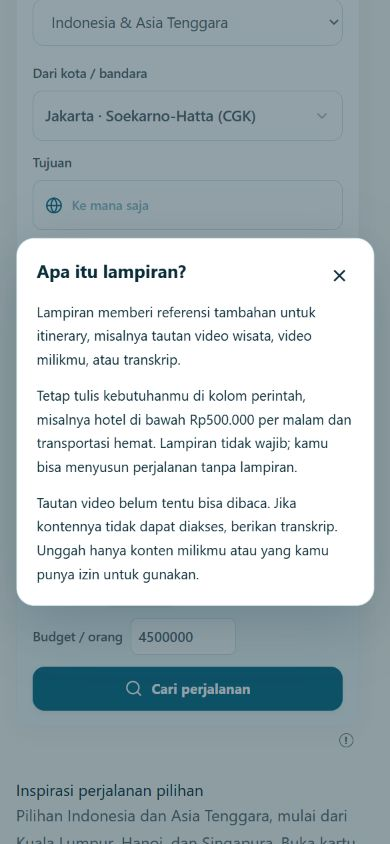

# Laporan Tahap 2 — SortTrip AI Travel Agent

Tanggal: **27 Oktober 2026, Asia/Jakarta**  
Status keseluruhan: **PARTIAL — implementasi lokal tersedia, integrasi video/Meta nyata belum terverifikasi**  
Branch: `codex/meta-hackathon-phase-2-2026`  
Baseline HEAD: `737fbc5636145fc27a0bf4ac41be831835dfbd44`  
Status rilis: **belum commit, push, atau deploy untuk perubahan Tahap 2 ini**.

Laporan ini merangkum implementasi Tahap 2 dan perbaikan terbaru berdasarkan source, laporan QA, log pengujian, serta pemeriksaan browser lokal. Status operasional dibedakan dari hasil simulasi; kelulusan tes tidak berarti video nyata telah dianalisis.

## 1. Hasil utama

Fitur referensi video kini menyatu dengan **SortTrip Assistant** di Jelajahi dan halaman itinerary. Pengguna tetap dapat menulis perintah, caption, budget, dan preferensi sambil memilih lampiran opsional. Tidak perlu memilih antara perintah teks dan referensi media.

Contoh kebutuhan yang didukung oleh alur input: menambahkan referensi wisata sekaligus meminta hotel di bawah Rp500.000 per malam, transportasi hemat, dan malam terakhir dekat KLIA. Ini adalah kemampuan penggabungan input dan konteks planner; keberhasilan satu permintaan nyata tetap memerlukan akses model dan data mitra yang sesuai.

Seluruh ikon **!** keterangan kini menggunakan panel pop-up. Keterangan tidak lagi memperpanjang kolom formulir. Ikon Trip Pass yang sebelumnya memakai mekanisme terpisah juga telah disatukan.

## 2. Implementasi lokal

| Bagian | Hasil | Batas verifikasi |
|---|---|---|
| Assistant terpadu | Perintah utama dan preferensi tetap tersedia bersama lampiran | UI lokal teruji; rantai model nyata belum dijalankan |
| Lampiran opsional | Tanpa lampiran, tautan video, unggah MP4, atau transkrip | Pengenalan tautan bukan bukti akses isi video |
| Tautan sosial | Validasi dan normalisasi TikTok, Instagram Reel, YouTube Shorts; penolakan domain palsu | Tidak mengunduh video atau melewati pembatasan platform |
| Unggah MP4 | Batas ukuran, persetujuan, validasi struktur container, pembatalan dan error | Belum decoding, ekstraksi suara/frame, atau analisis visual |
| Adapter Meta | Request transkrip di server, schema ketat, timeout, tanpa retry/fallback berbayar | Diuji dengan mock; belum ada respons Meta nyata |
| Review tujuan | Tinjau, ubah, tambah, hapus dan deduplikasi kandidat sebelum planning | Identitas lokasi terverifikasi masih terbatas pada dua museum KL |
| Integrasi itinerary | Kandidat yang ditinjau dan perintah diteruskan ke planner yang sudah ada | Save/RLS dua akun dan alur penuh live belum disertifikasi |
| Perlindungan itinerary | Jalur lama untuk kuota, item dibeli/pending, serta item dikunci tetap digunakan | Tidak ada booking atau pembayaran untuk pengujian ini |
| Bahasa dan responsif | Label/keterangan Indonesia–Inggris, penyesuaian layar kecil | Bahasa konten yang ditulis pengguna tidak diterjemahkan otomatis |

Caption dan bukti transkrip dikirim sebagai data yang terpisah. Caption tidak boleh dianggap sebagai bukti isi video. Metadata yang diteruskan ke itinerary dibatasi pada kandidat tempat yang ditinjau; video, transkrip mentah, dan respons model mentah tidak disimpan dalam Trip.

Di Jelajahi, tindakan eksplisit setelah review dapat membuat draft perjalanan baru dan meminta planner awal. Keberadaan metadata lampiran pada perjalanan tersimpan tidak otomatis memicu permintaan AI. Kegagalan membaca media tidak diam-diam dialihkan menjadi permintaan teks berbayar.

## 3. Perubahan UI terbaru

- Ikon **!** membuka panel berjudul dengan isi keterangan yang sesuai.
- Panel dapat ditutup lewat **×**, **Escape**, atau klik di luar panel.
- Fokus keyboard berada dalam panel dan kembali ke ikon setelah ditutup.
- Panel dapat digulir jika isinya panjang; kolom di belakangnya tidak bertambah tinggi.
- Keterangan lampiran menjelaskan contoh penggunaan bersama perintah, sifat opsional, keterbatasan akses tautan, dan izin penggunaan konten.
- Trip Pass mempertahankan informasi kuota/masa berlaku, pemeriksaan status, serta akses Price Watch di dalam panel. Informasi pembelian penting tetap terlihat pada kondisi belum memiliki atau kehabisan pass.

Pemeriksaan browser langsung mencakup panel lampiran, tanggal bebas, panduan Assistant, dan cakupan/harga. Interaksi live pemeriksaan status Trip Pass serta Price Watch di dalam panel belum dioperasikan; migrasi source dan regresi pembayaran telah diperiksa.

## 4. Hasil QA dan bukti

| Pemeriksaan | Hasil | Keterangan |
|---|---|---|
| Regresi setelah penggabungan caption/lampiran | **384 lulus, 0 gagal, 0 dilewati** | Unit/mock; hasil sebelum perubahan panel global terakhir |
| Tes terarah setelah panel global | **25 lulus, 0 gagal, 0 dilewati** | Disclosure UI, attachment UI, dan pembayaran; bukan tambahan 25 tes unik terhadap 384 |
| TypeScript dan build terbaru | **Lulus** | Peringatan bundle utama >500 kB masih ada |
| Cakupan lokalisasi terbaru | **1.587 key, 0 error** | Tidak ditemukan literal JSX belum diterjemahkan dalam cakupan scanner |
| Browser Indonesia–Inggris | **Lulus pada cakupan yang diuji** | Keterangan dan kontrol panel diterjemahkan |
| Desktop dan ponsel | **Lulus pada cakupan yang diuji** | Ponsel 390 px: panel 358 px, dokumen 390 px; tidak meluber horizontal |
| Tutup dan keyboard | **Lulus** | Tombol tutup, Escape, klik luar, pengembalian fokus dan Tab dalam modal |
| Meta/video nyata dan Save/RLS | **Belum terverifikasi** | Tidak diklaim lulus dari mock |

Suite penuh 384 tidak diulang setelah perubahan panel global; validasi terakhir memakai 25 tes yang terkait dan build. Lint belum dikonfigurasi. Temuan dependency tooling yang diwarisi dari audit sebelumnya belum diselesaikan dalam pekerjaan ini.

Bukti pendukung:

- [QA gabungan Assistant](../../../qa-reports/assistant-combined/QA_REPORT.md)
- [Log 384 tes](../../../qa-reports/assistant-combined/tests.log)
- [Log 25 tes terbaru](../../../qa-reports/assistant-combined/info-panels-tests.log)
- [Log build terbaru](../../../qa-reports/assistant-combined/info-panels-build.log)
- [Tampilan panel ponsel](../../../qa-reports/assistant-combined/info-panel-mobile-id.png)

## 5. Keamanan, biaya dan tindakan yang tidak dilakukan

Pengeluaran Meta aktual dalam pekerjaan ini: **USD0**. Tidak ada model Meta nyata yang dipanggil. Batas pengujian USD5 merupakan batas izin, bukan target belanja atau hard cap yang sudah terbukti bekerja.

Source SQL/RPC pembatas anggaran telah disiapkan dengan alokasi global, tetapi belum diterapkan atau diuji operasional. Credential dan entitlement akun tetap ditangani owner. Tidak ada secret yang dibaca atau diubah, migrasi database, provisioning infrastruktur berbayar, pengiriman pesan pelanggan, pembayaran, atau pemesanan nyata.

## 6. Pekerjaan tersisa

1. **Akses Meta dan privasi:** owner memverifikasi entitlement model, kredit, persyaratan data, serta memasang credential secara privat di server.
2. **Batas biaya:** tinjau dan terapkan SQL di nonproduction, lalu verifikasi konkurensi, batas token/biaya, dan penolakan saat anggaran habis sebelum mengaktifkan panggilan berbayar.
3. **Transkrip nyata:** setelah gate akses/biaya lolos, uji satu konten berizin dan catat kualitas hasil, latensi, serta penggunaan aktual tanpa data sensitif.
4. **Video nyata:** implementasi pemroses media aman, decoding, durasi/track, ekstraksi audio/frame, pengiriman yang didukung model, serta penghapusan file remote jika digunakan.
5. **Lokasi:** perluas verifikasi identitas tempat dan sumber jam buka, tarif, serta rute. Jangan mengisi koordinat atau harga yang tidak terbukti.
6. **Save dan isolasi akun:** uji draft, simpan/buka kembali, serta akses dua pengguna dengan akun nonproduction yang dapat dibuang.
7. **Regresi akhir dan rilis:** ulangi suite penuh setelah pekerjaan lanjutan, cek alur panel Trip Pass/Price Watch, dan lakukan review rilis. Commit/push/deploy memerlukan instruksi owner; credential tetap owner-controlled.
8. **Hackathon:** pastikan aturan kelayakan, penggunaan kode yang sudah ada, izin media dan persyaratan submission telah ditinjau owner.

Rincian gate: [OWNER_ACTION_REQUIRED.md](OWNER_ACTION_REQUIRED.md).

## 7. Keputusan tahap

**Tahap 2 belum selesai sepenuhnya.** UI terpadu, adapter transkrip, validasi, review, integrasi planner lokal, dan perbaikan panel sudah tersedia. Analisis video nyata, penggunaan Meta live, hard cap operasional, dan Save/RLS end-to-end masih terbuka.

**Tahap 3: NOT READY.** Tidak ada aktivasi agent otonom, optimisasi lintas mitra, atau rilis produksi yang diotorisasi oleh laporan ini.

## Pembaruan berikutnya: Tahap2B
Laporan di atas adalah checkpoint sebelum Tahap2B. Lihat PHASE_2B_IMPLEMENTATION.md untuk status terbaru: fallback frame browser dan ekstraksi frame/audio CLI lokal sudah benar-benar diuji, katalog kini5identitas, preflighttoken/control diperkuat, suite penuh398tes lulus. Meta live, ledgerSQL nyata, Save/RLS duaakun dan demo nyata masih belum lolos. Tidak ada deploy atau panggilan Meta berbayar. Panduan setup sederhana ada di OWNER_ACTION_REQUIRED.md.
