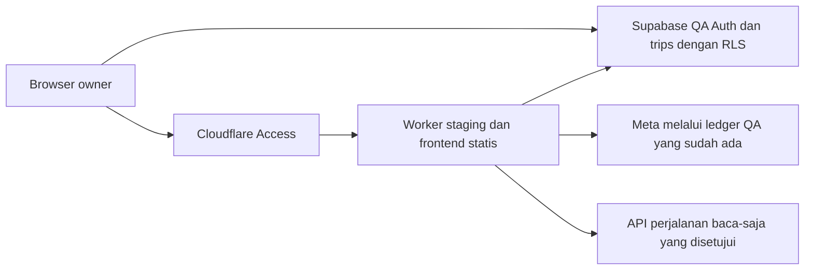

# Audit dan Usulan Staging SortTrip untuk Owner

**Kelanjutan setelah audit:** owner telah mengizinkan persiapan implementasi lokal saja. Lihat [hasil persiapan dan checklist owner](IMPLEMENTATION_PREPARATION_2026-10-28.md). Batas output kini diselaraskan ke2.000 pada kode lokal; kondisi ledger aktual/penyebab429 belum dibuktikan. SQL, deployment dan inferensi nyata belum dijalankan. Audit di bawah dipertahankan sebagai checkpoint sebelumnya.

**28 Oktober 2026 · Hanya audit/usulan · Menunggu persetujuan sebelum implementasi**

Rekomendasi: satu URL staging terlindungi, menyajikan frontend dan API, terhubung hanya ke Supabase QA. Owner menggunakan identitas QA dan hak uji terbatas tanpa membeli Trip Pass lagi. Production, RLS dan batas pengeluaran dipertahankan. Penyebab penolakan ledger HTTP 429 harus dipastikan sebelum uji AI; URL staging atau Trip Pass baru tidak otomatis menyelesaikannya.

## 1. Konfigurasi yang ditemukan

| Bagian | Production/lokal biasa | QA saat ini |
|---|---|---|
| Frontend | `https://sorttrip.yusufridlo7.workers.dev/`; React main.jsx → AuthApp → TravelApp. vite.config.js: lokal 5173/preview 4173, proxy API 8787. | vite.meta-qa.config.js, mode meta-qa; 127.0.0.1:5174 atau localhost:5174, proxy 8790; envDir qa-config/meta/. |
| Supabase | Asset production yang diperiksa saat audit memakai `https://tznxfgosmjcmwoszvkdk.supabase.co`. | Frontend dan Worker memakai `https://aytrcvfncsklhqozreyk.supabase.co`. |
| Auth | Email/password; VITE_SUPABASE_URL dan VITE_SUPABASE_PUBLISHABLE_KEY ditanam saat build. Redirect signup mengikuti origin halaman. | Kode sama, identitas/session berasal dari QA. Akun dan pass production tidak otomatis menjadi akun/pass QA. |
| Worker | wrangler.jsonc: sorttrip, entry worker/index.js, compatibility2026-09-28/nodejs_compat; ASSETS=dist; Worker-first /api/* dan /hotel-checkout. | wrangler.meta-qa.jsonc: sorttrip-meta-qa-local, worker/meta-qa.js, env meta-qa; hanya lokal 8790; workers_dev=false, preview_urls=false, tanpa ASSETS. Host nonlokal ditolak. |
| Resource | HOTEL_BROWSER remote; KV RECOMMENDATION_BUDGETS ID04cc6be63be54cc2b23d5f8f4addee1c; AI_LIMITER578839:2/60 detik; VIATOR_LIMITER578840:10/60 detik; tiga cron. | AI_LIMITER901027:5/60 detik; tanpa KV/browser/cron production. |
| Meta | Manifest production tidak menetapkan flag Meta. Health aiConfigured memeriksa OpenAI lama, bukan kesiapan Meta. | META_VIDEO_NONPRODUCTION, META_VIDEO_TEXT_ENABLED, META_VIDEO_FRAMES_ENABLED, META_VIDEO_BUDGET_READY bernilai string true; model muse-spark-1.3. |

Manifest production: RECOMMENDATIONS_REFRESH_ENABLED=true, HOTEL_BROWSER_ENABLED=true, LITEAPI_ENABLED=true, LITEAPI_CHECKOUT_ENABLED=true, LITEAPI_CHECKOUT_MODE=live, LITEAPI_BOOKING_LIVE_APPROVED=true, GOOGLE_ROUTES_ENABLED=true, VIATOR_ENVIRONMENT=production, TRAVELPAYOUTS_MARKER=782849. URL White-label lama masih tersimpan; ini bukan bukti fitur tersebut digunakan/berfungsi.

Binding server QA: SUPABASE_PUBLISHABLE_KEY, SUPABASE_SECRET_KEY dan META_MODEL_API_KEY yang ditangani owner. Adapter baru mendukung secret Supabase modern melalui apikey; layanan lama tertentu masih mensyaratkan SUPABASE_SERVICE_ROLE_KEY/JWT. Nilainya tidak dibaca. Jangan menyelesaikan perbedaan ini dengan menyalin key production.

Pemeriksaan publik baru: homepage200; asset /assets/index-CWOfGrnq.js; health200/aiConfigured=true/flightsConfigured=true/itineraryRulesVersion2026-10-24-order-admission. Override dashboard, nilai credential, redirect Auth, mode Midtrans dan schema production tidak diperiksa. Source manifest tidak membuktikan seluruh konfigurasi runtime sama.

## 2. Akar hambatan perjalanan normal

- QA membutuhkan dua proses lokal, tidak memiliki hosting frontend, dan sengaja menolak host nonlokal. Konfigurasi ini tidak dapat langsung dipublikasikan sebagai staging.
- Login QA sebelumnya berhasil. Pemisahan proyek/origin menjelaskan mengapa session dan langganan production tidak terbaca; bukan bukti langganan owner hilang.
- Hasil SQL terakhir owner: trip_passes, ai_request_reservations, reserve_ai_request, finish_ai_request dan reserve_paid_ai_request belum ada. Alur access → reservasi hak AI berhenti sebelum inferensi. Error schema harus dibedakan dari permintaan membeli langganan.
- Router QA belum menyediakan itinerary AI lama, pembayaran/account-pass, hotel, aktivitas, Google Routes dan bantuan. AccountMenu masih meminta /api/payments/access. Preview tidak membuktikan seluruh fitur produk sudah terhubung.
- Save memakai app/database-trips.ts langsung ke Supabase dengan session pengguna dan RLS trips, bukan endpoint Worker /api/trips. Save/reload dan RLS pernah lolos nyata; jangan membuat ulang trips atau melemahkan RLS tanpa bukti perubahan schema.
- Discovery terbaru baru lolos fixture berlabel simulasi. Tiket QA nyata masih melalui proxy baca-saja ke Worker production; ini belum sepenuhnya mandiri dari resource production.

## 3. Diagnosis HTTP 429

Kode tercatat BUDGET_EXHAUSTED dihasilkan ketika reservasi ledger ditolak, sebelum token-count/inferensi Meta. HTTP 429 provider dipetakan ke RATE_LIMITED. Tidak ada bukti penolakan tercatat disebabkan tagihan Meta.

RPC menolak bila baris anggaran hilang/blocked, allocated+0,05>10, request owner belum settled dalam dua menit terakhir, atau owner sudah memiliki 10 alokasi sepanjang riwayat. Limiter Worker juga dapat menghasilkan429; access dan discover masing-masing memakai jatahnya, tetapi ini berbeda dari kode ledger yang tercatat.

**Cacat kontrak ditemukan:** discovery mengizinkan 4.000 output token, sedangkan settlement ledger menghentikan request berikutnya bila output>2.000. Respons panjang, termasuk hasil gagal validasi, dapat memicu blocked walaupun biayanya di bawahUSD0,05. Ini penyebab yang masuk akal, belum konfirmasi kondisi database saat insiden. Regresi sebelumnya belum membuktikan kesesuaian kedua batas tersebut.

[SQL diagnosis baca-saja](sql/01_READ_ONLY_DIAGNOSTIC.sql) memeriksa kondisi global/per-owner dan sidik fungsi terpasang tanpa mengeluarkan identitas. Belum dijalankan. Snapshot baru tidak otomatis merekonstruksi insiden lama. Jangan menggunakan probe historis yang melakukan write sementara.

Usulan setelah persetujuan: sesuaikan keluaran discovery ke guard 2.000 yang sudah ada, misalnya satu opsi ringkas untuk penerimaan awal. Jangan menaikkan guard menjadi4.000. Pertahankan USD 10 global, USD 0,05/request,10 alokasi/user, tanpa retry otomatis/pengembalian alokasi gagal. Jika blocked atau batas riwayat tercapai, berhenti untuk peninjauan terpisah; tidak mengusulkan reset, rotasi akun, ledger baru atau unblock otomatis. USD 9,70 hanyalah checkpoint lama.

## 4. Arsitektur yang disarankan

URL usulan, belum dibuat: `https://sorttrip-staging.yusufridlo7.workers.dev/`.

- Worker/config terpisah; build dist-staging; frontend/API satu origin, tanpa server laptop. Build hanya memakai URL/publishable key QA. Tinjau perilaku MODE, termasuk autoFlightAI dan alat QA; mode bernama staging saja tidak memberi isolasi.
- Gunakan daftar endpoint staging yang diizinkan, pemeriksaan host/proyek QA dan tidak ada fallback production. Jangan menyalin router/config production, KV production, HOTEL_BROWSER, cron, outbox/notifikasi, webhook, key pembayaran atau jalur booking. Referensi statis harus memiliki label sumber/usia; KV staging tersendiri hanya bila diperlukan.
- Cloudflare Access owner-only melindungi semua API/asset. Validasi signature, issuer, audience dan expiry assertion; jangan percaya header/email mentah. Tolak host alternatif dan preview URL tanpa proteksi; pemeriksaan aplikasi berjalan sebelum asset. [Validasi Access](https://developers.cloudflare.com/cloudflare-one/access-controls/applications/http-apps/authorization-cookie/validating-json/), [routing asset](https://developers.cloudflare.com/workers/static-assets/routing/worker-script/).
- API juga memverifikasi session QA, identitas terkonfirmasi dan UUID owner QA yang diizinkan server, serta mencocokkannya dengan identitas Access. Jangan memakai role user_metadata. Non-owner ditolak sebelum supplier/ledger. Akses langsung Supabase tetap menggunakan RLS pengguna.
- Tetap gunakan alur produk access → discover → itinerary, bukan preview yang melewati langganan/fixture. Sesuaikan account-pass; pembelian dan aksi lama yang tidak didukung dinonaktifkan dengan keterangan. Editor AI OpenAI lama tidak otomatis diaktifkan dalam lingkup penerimaan Meta ini.
- Ganti proxy tiket production dengan adapter supplier staging dan akses baca yang disetujui. Hotel/Viator opsional mengikuti akses partner yang sah. Jika tidak tersedia, tampilkan harga belum tersedia; jangan memakai fixture sebagai harga nyata.
- Secret hanya pada Worker staging: server key QA, Meta QA dan key supplier baca yang disetujui. Browser hanya URL/publishable key QA. Owner memeriksa scope secara privat; tidak ada pembuatan/perubahan credential sekarang. Environment harus eksplisit. [Environment Worker](https://developers.cloudflare.com/workers/wrangler/environments/), [jenis key Supabase](https://supabase.com/docs/guides/getting-started/api-keys).

## 5. Schema minimum dan hak uji owner

Untuk discovery staging saja, pertahankan Auth/trips/RLS dan ledger Meta. Tambahan minimum: dua tabel trip_passes/ai_request_reservations serta reserve_paid_ai_request yang ketat dan finish_ai_request idempoten. RPC ini tidak memakai free-basic, sehingga ai_membership_usage, reserve_ai_request, payment orders dan Price Watch tidak diperlukan. Ini lebih sempit daripada bundle QA lama, bukan klaim semua fitur lama kompatibel.

[Usulan SQL schema](sql/02_MINIMUM_QA_ENTITLEMENT_SCHEMA_PROPOSED.sql) berhenti bila objek ternyata sudah ada. RLS aktif; klien tidak dapat membaca/memberi pass atau menjalankan RPC kuota. Hanya hak server yang diperlukan diberikan. Trips/ledger dollar tidak diubah. SQL belum dieksekusi/diuji pada Postgres; owner wajib memeriksa proyek di dashboard karena SQL Editor tidak bisa diandalkan untuk menebak URL proyek. [Prinsip RLS](https://supabase.com/docs/guides/database/postgres/row-level-security).

[Usulan SQL hak uji](sql/03_OWNER_TEST_ENTITLEMENT_PROPOSED.sql): pass manual owner-test:staging: untuk UUID owner QA yang sudah ada, dua hasil berhasil/24 jam. Tanpa pembelian, salinan pass production, endpoint pemberian hak di browser atau role metadata. Tidak memberi ulang/reset jika pass sudah ada. Menolak blocked, unsettled atau kapasitas Meta tidak cukup. Hak hasil AI bukan tambahan kapasitas pengeluaran Meta. Pemberian/penarikan hak tetap tindakan owner setelah persetujuan.

## 6. Uji penerimaan nyata yang diusulkan

Belum dijalankan. Setelah diagnosis/persetujuan:

1. Owner login normal melalui URL staging tanpa server lokal. Catat versi, proyek QA dan guard. Kirim prompt Hanoi/Vietnam lima hari yang ringkas; lakukan satu inferensi Meta nyata, tanpa mengandalkan isi TikTok yang belum terbaca.
2. Wajib ada tujuan relevan, seluruh hari/malam dan output tervalidasi, tanpa fallback semua negara. Ambil minimal satu hasil tiket nyata dari API yang tersedia. Bedakan tarif indikatif/cache dari ketersediaan terkunci. Hotel/transportasi/admission tidak diketahui dilabeli belum tersedia, bukan gratis. Link tak terbaca meminta klarifikasi.
3. Buka kartu: tidak ada inferensi/pemotongan hasil kedua. Cocokkan tanggal, malam, pelancong, asumsi kamar, subtotal dan pengecualian. Periksa tautan Google Maps tanpa booking/pembayaran.
4. Edit item, Save dengan session QA, reload penuh dan buka Perjalanan saya. Data sama; Save/reopen tidak menggunakan AI baru. Tidak ada request ke Supabase/Worker production.
5. Uji penolakan anonim, non-owner, proyek/host salah sebelum model; uji negatif trips RLS dengan akun QA kedua tanpa hak AI. Periksa ID/EN dan desktop/mobile. Bukti disanitasi tanpa ID perjalanan pribadi.

Lulus hanya bila Meta nyata + tiket nyata + label harga belum tersedia + draft editable + Save/reload QA, dengan accounting/RLS benar. Fixture atauHTTP200 tanpa rencana valid tidak cukup. Hotel tidak tersedia berarti cakupan harga parsial. Respons terputus mungkin sudah diproses server; periksa sebelum retry yang diotorisasi terpisah.

## 7. Tindakan owner, penerapan dan rollback

Hanya setelah proposal disetujui:

1. Konfirmasi URL dan identitas Access/akun QA secara privat. Tinjau diagnosis429; bila kapasitas tidak tersedia, pertahankan AI nonaktif dan berhenti.
2. Tinjau SQL/proyek QA. Owner sendiri menerapkan perubahan yang disetujui serta memeriksa privilege/RLS. Jangan mengulang schema trips atau mengimpor data pelanggan production.
3. Atur Site URL/redirect tepat untuk staging pada Auth QA saja; tinjau pembatasan signup. Pasang Access deny-by-default dan pastikan scope API secara privat. [Redirect Supabase](https://supabase.com/docs/guides/auth/redirect-urls).
4. Tinjau build/config/endpoint/guard. Cocokkan proyek QA yang ditanam pada frontend dengan identitas runtime Worker sebelum login, Save atau AI diaktifkan; scan build menolak URL Supabase/Worker production, pola secret dan fixture. Tampilkan banner STAGING/QA permanen. Tanpa jalur transaksi, cron atau fallback production. Text/frame nonaktif sampai pemeriksaan tanpa pengeluaran lulus, lalu hanya kemampuan QA yang disetujui diaktifkan.
5. Minta persetujuan deploy staging tersendiri. Versi awal terkunci dan generasi nonaktif; verifikasi penolakan akses/proyek QA, baru aktifkan uji terbatas setelah izin. Proteksi dipasang sebelum URL diekspos. Bukan izin deploy production, commit/push atau Tahap 3.

Rollback: nonaktifkan generasi staging dan tutup Access terlebih dahulu; nonaktifkan route atau pulihkan versi Worker/asset staging terkunci. Production tidak diubah. Pertahankan trips QA, ledger, counter dan bukti; rollback kode tidak mengembalikan database/alokasi. Owner dapat secara terpisah mengakhiri pass/mencabut grant baru setelah memeriksa request berjalan. Jangan drop tabel, reset pemakaian atau clear blocked otomatis. Verifikasi kembali homepage/proyek/health publik dan versi production di dashboard tanpa inferensi/write production.

## 8. Checklist setelah persetujuan

- [ ] Persetujuan owner atas proposal dan lingkup staging.
- [ ] Penyebab429 dibuktikan; kontrak 4.000/2.000 diselaraskan ke bawah; cap tetap.
- [ ] Build/config/resource terpisah; host/proyek QA diperiksa.
- [ ] Access dan identitas owner; tanpa jalur publik alternatif.
- [ ] Schema/hak uji ditangani owner; trips RLS tetap.
- [ ] Secret modern/account-pass kompatibel, tanpa checkout/preview bypass.
- [ ] Adapter perjalanan baca-saja; label sumber/usia/harga tidak tersedia.
- [ ] Uji negatif auth/RLS, duplikasi, timeout/accounting; tanpa retry otomatis.
- [ ] Persetujuan deploy staging; smoke test tanpa pengeluaran sebelum generasi.
- [ ] Uji nyata Meta→API→itinerary→Save/reload dan rekonsiliasi ledger.
- [ ] Uji rollback dan serah terima satu URL.

Batas audit: source/config/bukti, dokumentasi resmi dan GET publik homepage/asset/health production saja. Tidak membaca file environment privat, menjalankan SQL, memanggil model, mengubah credential/billing/grant/batas pengeluaran, deploy, commit atau push. Bukti454 tes sebelumnya bersifat historis, bukan uji baru. Hanya dokumen usulan/SQL dan catatan progres ditulis. Berhenti di sini dan minta persetujuan sebelum implementasi.
