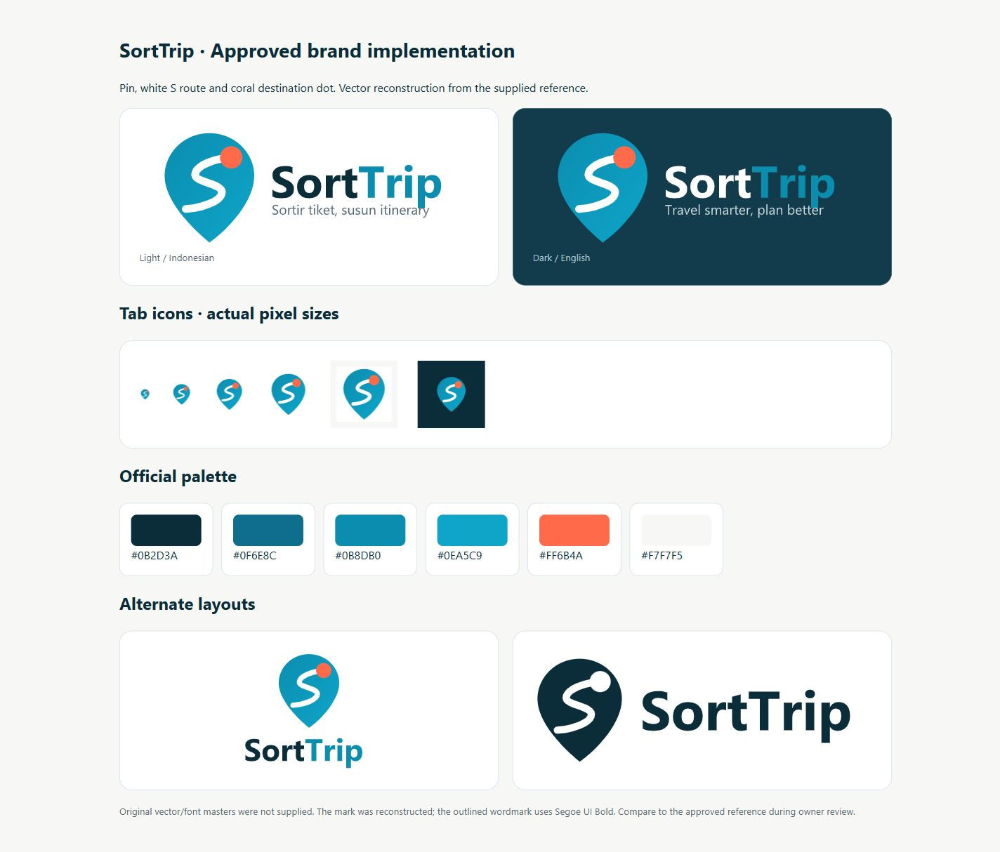

# Favicon QA

Date: 24 October 2026. Branch: `codex/approved-brand-identity-2026-10-24`. Status: local implementation ready for review; no commit, push or production deployment.

The approved pin/S/coral mark replaces the old root icon and all active entry references. No wordmark or tagline is in favicon artwork. SVG, multi-size ICO and16/32/48/64 PNGs are present. Apple180, app192/512 and maskable512 are valid. Tests inspect decoded dimensions/alpha, ICO offsets and PNG entry signatures. Version3 URLs and matching root aliases address stale favicon caches.

`index.html`, terms, privacy and404 include the same icon, Apple, mask-icon, manifest, application-name and theme-colour metadata. Main tab title and sharing metadata change with language. Static legal titles retain their page meaning. Manifest is installation metadata only: no offline service worker or push capability was added.

The connected browser inventory exposes only the ChatGPT in-app browser plus MCP Apps; native Chrome, Edge and Firefox are not connected. Asset rendering was inspected in the in-app browser and the small-size gallery; declared favicon paths and byte-identical server responses were verified. Actual browser-chrome tab pixels, bookmark caches, installed home-screen appearance and Safari pinned-tab UI are **not claimed verified**. Optional manual checks are listed in OWNER_ACTION_REQUIRED.

