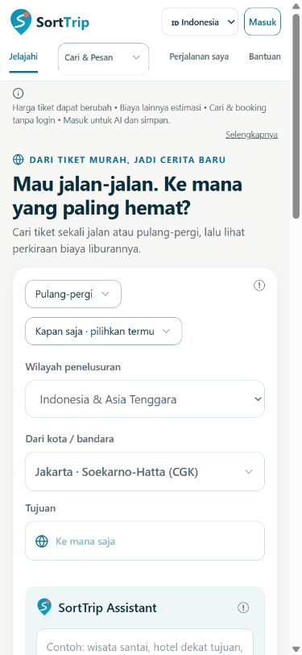
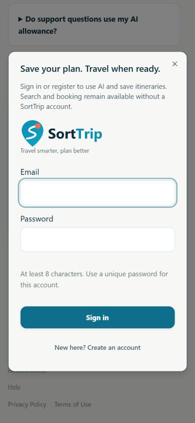

# Responsive QA

Date: 24 October 2026. Branch: `codex/approved-brand-identity-2026-10-24`. Status: local implementation ready for review; no commit, push or production deployment.

Exact viewport measurements were verified against requested widths rather than assuming a resize targeted the correct tab. The authoritative final capture is `evidence/responsive-final.json`; earlier exploratory JSON is superseded.

| Width | Indonesian | English | Horizontal overflow | Visible account label |
|---:|---|---|---|---|
|320|Pass|Pass|None|Yes|
|375|Pass|Pass|None|Yes|
|390|Pass|Pass|None|Yes|
|768|Pass|Pass|None|Yes|
|1024|Pass|Pass|None|Yes|
|1440|Pass|Pass|None|Yes|
|1920|Pass|Pass|None|Yes|

Desktop header76px; tablet two-row header144px; final phone header103–105px. The initial phone header233px and guest sign-in wrapping were corrected. A later tablet hidden-text regression was fixed with a scoped visible full account label; semantic button labels remain available. SVG mark scales proportionally and mobile navigation uses the existing booking selector.

Additional390px screenshots cover authentication/register forms, support FAQ, saved trips, Assistant/itinerary, map, costs, Price Watch, checkout and privacy. Desktop screenshots cover homepage, flights, transport and brand assets. No Google route call, booking or financial action was needed for these checks.

