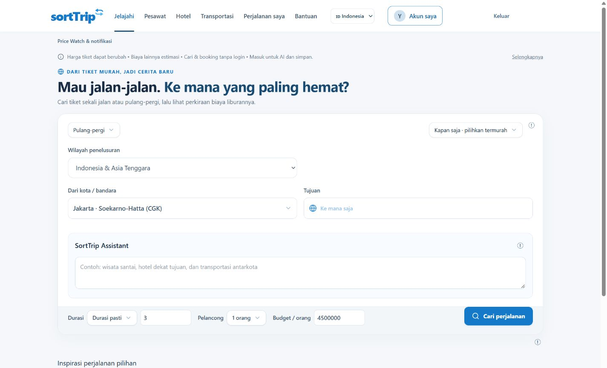
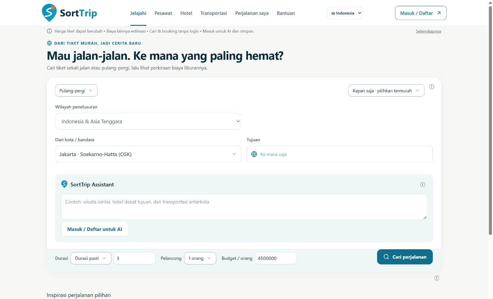
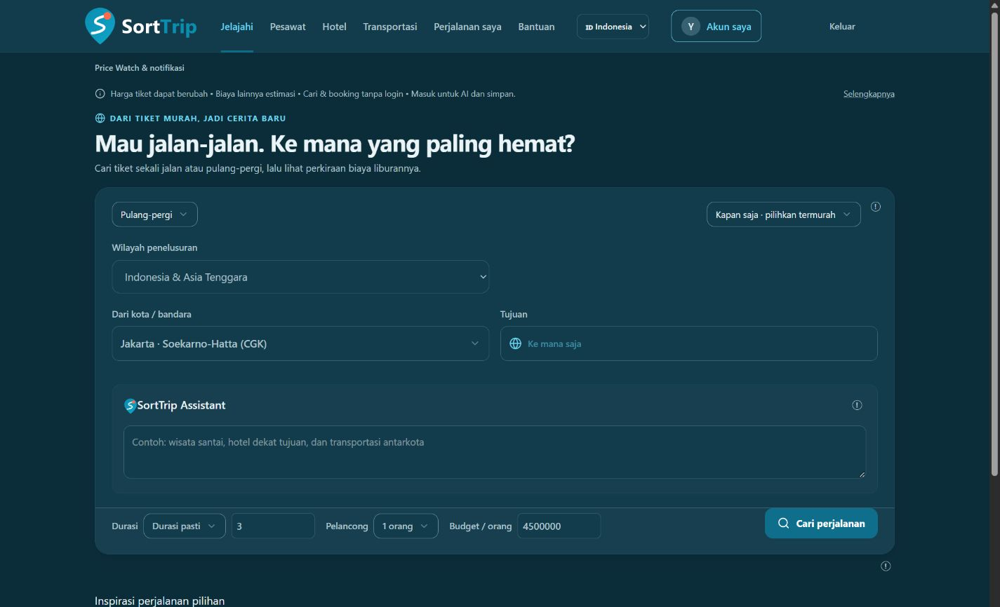

# Visual regression review

Date: 24 October 2026. Branch: `codex/approved-brand-identity-2026-10-24`. Status: local implementation ready for review; no commit, push or production deployment.

## Before / after

Baseline: `evidence/before-desktop.png`. Replaced the small outdated arrow wordmark with the approved pin/S/dot mark, using navy/cyan lettering. The page background changed from blue-grey to the approved warm off-white; controls use readable deep teal and cards retain the existing hierarchy. The full reference collage is not used as a website asset.

The original editable vector/font were unavailable. Pin outline and S are manually reconstructed with smooth paths; wordmark outlines are Segoe UI Bold. The supplied graphic's subtle gradients and exact glyph geometry are approximations, explicitly recorded for owner visual review. The written approved hex palette is used where the screenshot swatches and written brief differ. No globe/aircraft/compass substitute was introduced.

Small favicon S and coral dot remain visible in the review gallery. Initial gallery CSS accidentally stretched icons; it was fixed to display declared pixel sizes. Initial phone navigation wrapping and mobile/tablet account-label visibility were fixed. Logo assets need no remote font or media request.

These are human visual comparisons and DOM/asset assertions, not a pixel-perfect golden-image or perceptual-diff certification. Third-party iframe internals and real payment/3DS screens are excluded.
